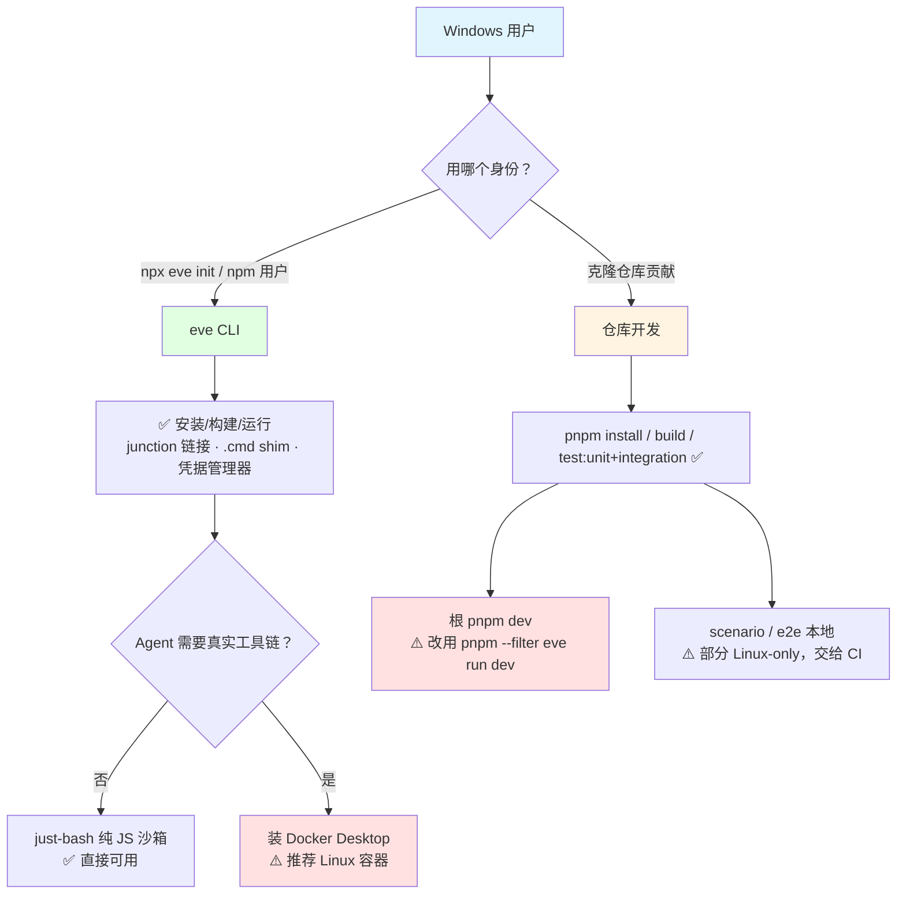

# eve - Windows 兼容性分析

> 生成时间: 2026-10-17
> 分析对象: D:\dev\git\z_jordon\fork\eve（主包 eve@0.80.1，main 分支 c8332e1f）
> 数据来源: windows-compat-checker.sh 全仓扫描 + 源码逐项审计

## 总体评估

| 指标 | 结果 |
|------|------|
| 总体评级 | ⚠️ 部分兼容（接近 ✅）——**终端用户 CLI：✅ 完全兼容；仓库贡献者：⚠️ 两个中危点** |
| 高危问题（阻断） | 0 |
| 中危问题 | 2（本地沙箱依赖 Docker Desktop；根 `pnpm dev` 编排脚本） |
| 低危问题 | 3（模板 setup.sh 仅 bash；旧 conhost 字形降级；部分测试在 win32 跳过） |
| 已正确适配项 | 12+（见第 7 节） |

**核心结论**：Windows 是 eve 的一级受测平台——CI 的 integration 矩阵含 `windows-latest`（`.github/workflows/ci.yml:105-113`），CHANGELOG 记录了大量 Windows 专项修复（路径冒号、EPERM 重试、8.3 短路径崩溃、cmd.exe shim 探测等）。源码中有约 50 处 `process.platform` 分支，全部目的明确。未发现阻断项。

### 评级说明

| 等级 | 含义 |
|------|------|
| ✅ 完全兼容 | 项目可在 Windows 上正常构建和运行 |
| ⚠️ 部分兼容 | 可构建但部分功能不可用，需少量修复 |
| ❌ 不兼容 | 无法在 Windows 上构建或核心功能不可用 |

## 1. 构建系统兼容性

### 1.1 package.json Scripts

| Script | 命令 | 问题 | 严重程度 |
|--------|------|------|----------|
| `docs:check` / `release` / `version-packages` | `node … && node …` | 脚本扫描器标记 `&&`，但 pnpm 在 Windows 走 cmd.exe，`&&` 原生支持 | ✅ 无问题 |
| 全部 scripts | 均为 `node ./scripts/*.mjs` 或 `turbo run` | 纯 Node 编排，无 bash 语法 | ✅ 无问题 |

### 1.2 生命周期 Hooks

| Hook | 命令 | 问题 | 严重程度 |
|------|------|------|----------|
| `prepare` | `node ./scripts/install-git-hooks.mjs` | 纯 Node；经 `git config core.hooksPath .githooks` 安装钩子，**不用符号链接** | ✅ 无问题 |

### 1.3 构建工具链

| 工具 | Windows 支持 | 说明 |
|------|-------------|------|
| pnpm 12.7.0 | ✅ | Windows 默认 junction 链接，无需管理员/开发者模式；`pnpm-workspace.yaml` 无 node-linker 特殊配置 |
| Turborepo 2.x | ✅ | 官方支持 Windows |
| Node >= 24 | ✅ | `.nvmrc` = 24；`bin/eve.js` 用 vendor 的 semver 校验引擎 |
| nitro 3 (rolldown) | ✅ | 构建产物含 Windows 平台目标 |
| oxlint / oxfmt / syncpack | ✅ | 纯 JS 工具 |

## 2. 源代码兼容性

### 2.1 child_process 调用（宿主侧全部平台适配）

| 位置 | 调用方式 | 评估 |
|------|----------|------|
| `src/setup/primitives/pm/shared.ts:25`、`pm/pnpm.ts:264`、`internal/testing/run-pnpm-command.ts:106`、`internal/application/optional-package-install.ts:359` | win32 下用 `.cmd` shim + `shell: true` 调 pnpm/npm | ✅ |
| `src/setup/primitives/run-vercel.ts:136,152` | `vercel.cmd`/`vercel.exe` 候选 + `shell: true` | ✅ |
| `src/cli/commands/init-git.ts:50` | `execFile("git", …, { windowsHide: true })` | ✅ |
| `src/self-modification/extension/eve-add.ts:46-66` | win32 用 `taskkill.exe /pid <pid> /t [/f]` 杀进程树（SystemRoot 解析） | ✅ |
| `src/cli/commands/registry-setup-command.ts:224,332` | `detached: process.platform !== "win32"` | ✅ |
| `bin/eve.js` | 纯 Node，无 shell | ✅ |

**关键设计**：所有 POSIX shell（`/bin/sh`、bash 启动器）都运行在**沙箱引擎内部**（`execution/sandbox/bash.ts`、Docker 容器内 `/bin/sh`、just-bash 纯 JS 解释器），不在宿主上执行——Windows 宿主无需 bash。

### 2.2 平台相关代码（~50 处 `process.platform` 分支，全部有意为之）

| 文件 | 分支内容 |
|------|----------|
| `src/cli/telemetry/preference.ts:25` | win32 配置目录 `%AppData%\Roaming\eve`（有测试覆盖） |
| `src/setup/primitives/open-url.ts:5-12` | win32 `cmd /c start` 开浏览器；darwin `open`；其余 `xdg-open` |
| `src/cli/dev/tui/clipboard.ts:26-31` | win32 `clip`；OSC 52 备选 |
| `src/cli/dev/tui/theme.ts:251-262` | 旧 conhost 降级 ASCII 字形；Windows Terminal（`WT_SESSION`）/VS Code 用 Unicode；`EVE_TUI_UNICODE` 可覆盖 |
| `src/public/models/openai/chatgpt/credential-store.ts:228` | Windows 凭据管理器（just-secrets）；文档 `docs/reference/typescript-api.md:193` 注明 PowerShell 要求 |
| `src/internal/model-auth/vercel-cli.ts:26-105` | APPDATA 路径、`vercel.cmd` 解析、win32 createRequire 修正 |
| `src/execution/sandbox/bindings/microsandbox-platform.ts:65` | win32 明确排除并给出可行动错误（仅 darwin-arm64/Linux-KVM） |
| `src/execution/sandbox/bindings/docker-cli.ts:107-133` | 探测 `Server.Os == linux`——Windows 上 Docker Desktop 的 Linux 容器即合格 |
| `src/cli/dev/local-server-process.ts:237,247` | win32 跳过 `process.kill(-pid)` 进程组杀法 |

### 2.3 Unix 专用 API

| API | 文件 | Windows 处理 |
|-----|------|-------------|
| 进程组信号 `kill(-pid)` | `local-server-process.ts` | ✅ 已守卫；孙进程泄漏风险见低危项 |
| SIGTERM→SIGKILL 升级 | `local-server-process.ts:187`、`start-production-server.ts:165` | ✅ Windows `kill()` 映射 TerminateProcess，可接受降级 |
| Unix domain socket / named pipe | — | ✅ 全仓未使用；本地服务器一律绑定 `127.0.0.1` TCP；子进程 IPC 用 stdio `"ipc"` |
| POSIX 权限位测试 | `atomic-write-file.integration.test.ts:44` 等 | ✅ `skipIf(win32)` 且注明原因 |

## 3. 文件系统兼容性

### 3.1 路径处理（Windows 正确性是被显式工程化的）

| 处理 | 文件 | 说明 |
|------|------|------|
| 盘符/UNC → `file://` URL | `src/internal/application/import-specifier.ts:6-72` | ESM 导入 Windows 绝对路径必需 |
| Windows 安全资源目录 | `src/compiler/workspace-resources.ts:75` | URL 编码且无 `:`（CHANGELOG 修复 01cb6b4：子 Agent id 含 `:` 曾产出非法 Windows 路径） |
| 盘符剥离 | `src/discover/project-source.ts:308` | 内存源路径规范化 |
| 大小写不敏感比较 | `src/internal/nitro/host/create-application-nitro.ts:237` | win32 下小写化 |
| 8.3 短路径规范化 | `src/internal/application/output-publication-lock.ts:318` | 修复短路径崩溃（CHANGELOG 82fba04） |
| 忙文件重试 | `src/shared/atomic-write-file.ts:11-13` | 替换时重试 `EPERM/EACCES/EBUSY`——显式针对 Windows 文件占用语义 |
| 锁与 EPERM | `optional-package-install.ts:350`、`output-publication-lock.ts:39` | O_EXCL 式锁 + EPERM 感知的 pid 检查；`local-world-file-reads.test.ts:46` 在所有 CI OS 上重试瞬态 EPERM 读 |

全仓未用 `upath`/`pathe`/`cross-spawn`/`execa` 等兼容库——统一 `node:path`。硬编码 POSIX 路径（`/tmp/.eve/jobs`、`/workspace`、`/usr/local/lib/eve-code`）均为**沙箱内虚拟路径**，非宿主路径。

### 3.2 符号链接

- 生产源码无 `fs.symlink`；测试中出现的链接刻意用 `"junction"`（`resolve-eve-binary.integration.test.ts:40`），说明对 pnpm 的 Windows junction 布局有认知。
- pnpm Windows 默认 junction，安装无需管理员/开发者模式。

## 4. Shell 和脚本兼容性

### 4.1 Shell 脚本

| .sh 文件 | .ps1 | .cmd | 说明 |
|----------|------|------|------|
| `apps/templates/eve-chat-template/scripts/setup.sh` | ✗ | ✗ | **仅部署期一次性配置**（pnpm install、vercel link、Neon/Upstash 集成、OAuth 注册、env pull、DB 迁移）。本地 `eve dev` 永不调用。可在 Git Bash 下运行（其调用的 vercel/node/pnpm 均跨平台），或手工执行等价步骤 |
| `apps/templates/eve-voice-template/scripts/setup.sh` | ✗ | ✗ | 同上，额外采集 AI Gateway key |

### 4.2 环境变量

- `.env` 加载由 eve 自身完成（`src/cli/dev/environment.ts`），跨平台。
- 脚本内 `set -a; . ./.env.local`、`read </dev/tty` 仅存在于上述 setup.sh。

## 5. 测试和 CI/CD 兼容性

### 5.1 CI 配置

| 工作流 | Runner | Windows 支持 |
|--------|--------|-------------|
| `ci.yml` | ubuntu ×3 + **matrix [ubuntu-latest, windows-latest]**（integration） | ✅ Windows 是受测平台 |
| `bundle-analysis.yml`、`docker-image-size-analysis.yml`、`release.yml`、`e2e-*.yml`、`eve-code-benchmark.yml` | ubuntu-latest | — 仅 Linux（贡献者摩擦，非运行时问题） |

### 5.2 测试覆盖

| 测试类型 | Windows 覆盖 | 说明 |
|----------|-------------|------|
| 单元 / 集成 | ✅ | 集成在 windows-latest 常跑；个别 POSIX 专属用例 `skipIf(win32)` 注明原因（权限位、microsandbox KVM、channel conformance） |
| 场景 / 浏览器 / 框架 fixture | 部分 | 本地可在 Windows 跑（须带 tier config）；CI 矩阵未含 Windows |
| E2E（`e2e/`） | ✗ | 仅 CI、仅 Linux |

## 6. 依赖兼容性

### 6.1 原生模块

| 依赖 | 说明 |
|------|------|
| 运行时依赖仅 `nitro` + `undici` | 无原生编译 |
| `sharp`、`bufferutil`、`cpu-features`、`ssh2` 等可选原生件 | `pnpm-workspace.yaml` 的 `allowBuilds`/`ignoredOptionalDependencies` 已按预构建/可忽略处理，Windows 安装无编译负担 |
| playwright-core（computer-use/浏览器测试） | 官方支持 Windows |

## 7. 已正确处理的适配（亮点）

| 适配项 | 位置 | 处理方式 |
|--------|------|----------|
| 配置目录 | `cli/telemetry/preference.ts:25` | `%AppData%\Roaming\eve` |
| 打开浏览器 | `setup/primitives/open-url.ts` | `cmd /c start` |
| 剪贴板 | `cli/dev/tui/clipboard.ts` | `clip` + OSC 52 |
| TUI 字形 | `cli/dev/tui/theme.ts` | conhost 降级 ASCII，WT/VS Code 用 Unicode |
| 进程树终止 | `self-modification/extension/eve-add.ts` | `taskkill /t /f` |
| pnpm/npm/vercel 调用 | `setup/primitives/*` | `.cmd` shim + `shell: true` |
| 凭据存储 | `chatgpt/credential-store.ts` | Windows 凭据管理器 |
| 盘符路径 | `internal/application/import-specifier.ts` | 转 `file://` URL |
| 忙文件原子写 | `shared/atomic-write-file.ts` | EPERM/EACCES/EBUSY 重试 |
| Docker 沙箱探测 | `sandbox/bindings/docker-cli.ts` | 认可 Docker Desktop 的 Linux 容器 |
| microsandbox 排除 | `sandbox/bindings/microsandbox-platform.ts` | 干净报错而非崩溃 |
| Windows 缺陷回归史 | `packages/eve/CHANGELOG.md` | 01cb6b4 / 86e13ff / 891aed8 / 0333a63 / 82fba04 / dd960df 等修复 |

## 8. 修复建议

### 8.1 必须修复 (HIGH)

无。

### 8.2 建议修复 (MEDIUM)

1. **本地沙箱能力（终端用户）**：默认沙箱链 Vercel → Docker(Linux 容器) → microsandbox → just-bash（`sandbox/providers/default.ts:38-58`）。Windows 上 microsandbox 不可用；**不装 Docker Desktop 时落到 just-bash**——纯 JS 解释器 + 虚拟文件系统，"不运行原生进程"（`docs/sandbox/just-bash.mdx:16`）。需要真实工具链（git/node/npm、eve-code 的受信工具）的 Agent，应在 Windows 上安装 Docker Desktop 并使用 Linux 容器。
2. **根 `pnpm dev` 编排脚本（贡献者）**：`scripts/dev.mjs:64-70` 以 `detached: true` 且无 `shell: true` 拉起 pnpm，`killProcessGroup` 用 `process.kill(-pid)`（23-40 行）——原生 Windows 下 `.CMD` shim + 无进程组会失败。仓库贡献者请改用 `pnpm --filter eve run dev`，或在 Git Bash/WSL 下运行。**已发布 `eve` 包不受影响**（其自身 spawn 路径均 shell 感知）。

### 8.3 可选改进 (LOW)

1. 两个模板 `setup.sh` 补一份 PowerShell 版（或在文档标注 Git Bash 可用）。
2. 旧 conhost 用户建议改用 Windows Terminal / VS Code 终端以获得 Unicode TUI（或设 `EVE_TUI_UNICODE`）。
3. win32 跳过的 channel conformance 套件如可行可做平台参数化，缩小 Windows 覆盖差。

## 9. 兼容性流程图

## 总结

eve 对 Windows 的兼容不是"碰巧能跑"，而是**被当作一级平台持续工程化**：CI 常跑 Windows 集成测试、约 50 处有意的平台分支、一整套 Windows 文件语义防御（EPERM 重试、8.3 路径、盘符 URL 化），CHANGELOG 里连续多个 Windows 专项修复。对终端用户，`npx eve` 在 Windows 上开箱即用，唯一实质约束是"重沙箱工作负载建议配 Docker Desktop"；对仓库贡献者，避开根 `pnpm dev` 编排脚本即可顺畅工作。
