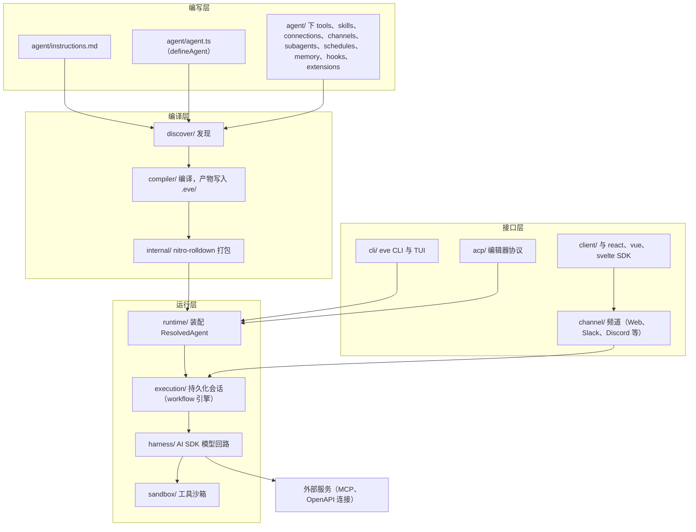
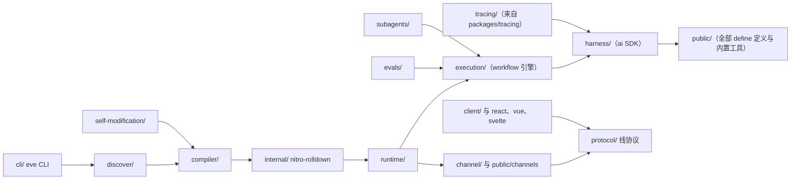

# eve - 架构分析

> 生成时间: 2026-10-17
> 分析对象: D:\dev\git\z_jordon\fork\eve（fork 自 vercel/eve，main 分支 c8332e1f）

## 1. 项目概览

### 1.1 项目信息

| 项目   | 内容                                                                       |
| ------ | -------------------------------------------------------------------------- |
| 名称   | eve（monorepo 根包名 `eve-monorepo`；主包 `eve@0.80.1`）                   |
| 语言   | TypeScript（4928 个 .ts 文件 + 7 个 .js），ESM                             |
| 类型   | AI Agent 框架 + CLI（npm 包 `eve`）                                        |
| 描述   | Filesystem-first framework for durable backend AI agents that run anywhere |
| 作者   | Vercel（本仓库为其 fork：github.com/zjordon/eve）                          |
| 构建   | pnpm workspace + Turborepo + tsdown/rolldown（经 nitro）、oxlint/oxfmt     |
| Node   | >= 24（`.nvmrc` 锁定 24），pnpm 12.7.0                                     |
| 许可证 | Apache License 2.0                                                         |

### 1.2 目录结构

```text
eve/
├── packages/
│   ├── eve/                  # ★ 框架本体 + eve CLI（唯一发布主包）
│   ├── eve-catalog/          # @eve/catalog：集成身份目录（频道/连接/扩展的 slug 清单，未发布）
│   ├── eve-code/             # @eve/code：eve/extensions/code 内置扩展的源码（CLI 编码工作流）
│   ├── eve-git/              # @eve/git：eve/extensions/git 内置扩展（GitHub PR 工作流）
│   ├── eve-computer-use/     # @eve/computer-use：Linux 沙箱桌面 computer-use 扩展
│   ├── eve-self-modification/# @eve/self-modification：自修改能力兼容入口
│   └── tracing/              # @vercel/agent-runs：框架无关 OTel 追踪 + 持久化 checkpoint
├── apps/
│   ├── docs/                 # 文档站点（Fumadocs）+ registry（eve add 的集成源）
│   ├── fixtures/             # 共享 Agent fixture（weather-agent、TUI client 等）
│   ├── frameworks/           # Next/Nuxt/SvelteKit/TanStack 框架集成验证应用
│   ├── templates/            # 模板画廊源项目（chat、voice、company-brain、llm-council…）
│   └── benchmarks/           # 基准
├── docs/                     # 发布的文档内容（随 eve npm 包分发）
├── e2e/                      # fixture 自有的 eve eval 端到端测试 + matrix.json
├── research/                 # issue 驱动的实现计划文档
├── scripts/                  # 仓库脚本（dev.mjs、guard-invariants.mjs…）
└── skills/ .agents/skills/   # 供编码 Agent 使用的技能（gh-pr-description、test-audit）
```

## 2. 架构设计

### 2.1 架构模式

eve 是一条**分层流水线架构**，外加"约定优于配置"的文件系统即接口（filesystem-as-API）模式：

1. **文件系统即编写界面**：Agent 的全部能力放在约定路径（`agent/instructions.md`、`tools/`、`skills/`…），标识符从文件路径派生，定义内不写 `name` 字段（编码原则 7）。
2. **编译器流水线**：`discover → compile → bundle → resolve → execute`，把 authored 目录变成可部署产物（写入 `<appRoot>/.eve/`），运行时只消费编译产物。
3. **持久化执行（durable execution）**：每轮对话是 durable workflow（Vercel `@workflow/*` 引擎），崩溃可恢复。
4. **精益内核 + 扩展生态**：`execution/` 与 `harness/` 是敏感核心，尽量不动；大功能（code、git、computer-use、self-modification）一律走 `defineExtension` 挂载，"eve 可以用 eve 构建"。
5. **运行时依赖极简**：`dependencies` 只有 `nitro` + `undici`（防 web_fetch SSRF），其余全部 devDependencies，构建时 vendor 进 `.generated/compiled` 并打进 dist —— 规避被劫持的传递依赖。

### 2.2 核心模块（packages/eve/src，37 个顶层目录）

| 模块                                    | 职责                                                                                                                                                         | 关键文件                                                                                         |
| --------------------------------------- | ------------------------------------------------------------------------------------------------------------------------------------------------------------ | ------------------------------------------------------------------------------------------------ |
| `discover/`                             | **发现**：扫描 authored 树（不 import 代码），解析 appRoot/布局（flat/nested）、槽位语法与冲突诊断                                                           | `discover/project.ts`、`discover-agent.ts`、`grammar.ts`、`filesystem.ts`                        |
| `compiler/`                             | **编译**：normalize 各槽位 → 写 `.eve/` 产物（manifest、module map、诊断）；扩展能力 epoch 契约                                                              | `compile-agent.ts`、`manifest.ts`、`normalize-*.ts`、`extension-compatibility.ts`                |
| `internal/`                             | **打包/宿主**：nitro-rolldown 打包 authored 模块；nitro 构建应用与扩展；测试基建                                                                             | `authored-module-loader.ts`、`bundler/nitro-rolldown.ts`、`nitro/host/build-application.ts`      |
| `runtime/`                              | **装配**：读 `.eve/` 产物 → `ResolvedAgent`（解析工具/钩子/频道/连接/沙箱/记忆/动态能力）                                                                    | `resolve-agent.ts`、`resolve-agent-graph.ts`、`loaders/`                                         |
| `execution/`                            | **持久化执行**：会话、durable session store、workflow 运行时（@workflow 引擎）、任务、收件箱、协调分发                                                       | `session.ts`、`durable-session-store.ts`、`workflow-runtime.ts`、`coordination-dispatch-step.ts` |
| `harness/`                              | **模型回路**：基于 Vercel AI SDK 的进程内 Agent loop——调模型、执行工具、输入抽取、生成引导、上下文压缩、HITL                                                 | `execute-call.ts`、`execute-tool.ts`、`compaction/`、`hitl/`、`authorization.ts`                 |
| `public/`                               | **发布 API**：全部 `define*` 定义、内置工具（bash/read_file/write_file/web_fetch/glob/grep…）、各平台频道、框架适配器（next/nuxt/sveltekit/tanstack/vercel） | `public/definitions/`、`public/tools/`、`public/channels/`                                       |
| `cli/`                                  | **CLI**：`bin/eve.js → dist/src/cli/run.js`；init/build/deploy/link/logs/trace/registry + dev/TUI                                                            | `cli/commands/`、`cli/dev/`                                                                      |
| `channel/` + `eve-channel/`             | 频道运行时核心（路由、鉴权、principal、投递）与默认 eve Web Chat 频道协议                                                                                    | `channel/`、`eve-channel/`                                                                       |
| `protocol/`                             | 客户端/服务端线协议（消息、事件 id、会话投影、路由、`eve__tool`/`eve__skill` 目录工具）                                                                      | `protocol/message.ts`、`routes.ts`、`catalog-tools.ts`                                           |
| `subagents/`                            | 子 Agent 调用、HITL 代理、事件代理、token 预算                                                                                                               | `subagents/`                                                                                     |
| `sandbox/`                              | 沙箱 provider 注册表（docker / just-bash / microsandbox / vercel）                                                                                           | `sandbox/providers/`                                                                             |
| `context/` + `dynamic/`                 | 请求/会话上下文容器与 `defineDynamic` 动态能力生命周期                                                                                                       | `context/`、`dynamic/`                                                                           |
| `evals/`                                | 评测框架（defineEval、judge、mock-model、runner、reporters）                                                                                                 | `evals/define-eval.ts`、`mock-model.ts`                                                          |
| `self-modification/` + `source-change/` | Agent 自修改扩展 + 对 authored 源码的 AST 编辑                                                                                                               | `self-modification/`、`source-change/agent-config-ast.ts`                                        |
| `client/` `react/` `vue/` `svelte/`     | `eve/client` 会话 SDK 与各 UI 框架的 `useEveAgent`                                                                                                           | `client/`、`react/`                                                                              |
| `setup/` `acp/`                         | `eve init` 脚手架流程；Agent Client Protocol（编辑器集成）                                                                                                   | `setup/`、`acp/`                                                                                 |

### 2.3 编译器流水线（核心链路）

```text
agent/ 目录（authored 源码）
   │  discover/project.ts        解析项目根与布局
   │  discover/discover-agent.ts 扫描树 → AgentSourceManifest（零 import）
   ▼
compiler/compile-agent.ts       normalize 各槽位 → 写入 <appRoot>/.eve/
   │                            （manifest + module map + diagnostics）
   ▼
internal/authored-module-loader.ts   nitro-rolldown 打包 authored TS/JS
   │  （缓存于 node_modules/.cache/eve/authored-modules）
   ▼
runtime/loaders/ + resolve-agent.ts  读产物 → ResolvedAgent
   ▼
execution/session.ts + workflow-runtime.ts   持久化会话与轮次
   ▼
harness/execute-call.ts + execute-tool.ts    AI SDK 模型回路
```

### 2.4 架构图



### 2.5 Agent 目录槽位（`discover/filesystem.ts` 的 `AgentRootEntryKind`）

| 槽位                                                                               | 形态                    | 说明                                                                |
| ---------------------------------------------------------------------------------- | ----------------------- | ------------------------------------------------------------------- |
| `agent.ts`                                                                         | ts/js/mjs/mts/cts 模块  | `defineAgent` 配置（模型、reasoning、限制）                         |
| `instructions.md` / `.ts` / 目录                                                   | md / 模块 / 目录        | 必填系统提示词；旧 `system.md` 已弃用并警告                         |
| `tools/`                                                                           | 一文件一工具            | **文件名即模型可见工具名**（`TOOL_SLUG_PATTERN`，禁止 name 覆盖）   |
| `skills/`                                                                          | SKILL.md 包或平铺 md/ts | 渐进披露，经 `eve__skill` 加载                                      |
| `connections/`                                                                     | 一文件一连接            | `defineMcpClientConnection` / `defineOpenAPIConnection`，kebab slug |
| `channels/`                                                                        | 路径即路由              | 路径段成为 URL 路由，可含 `[param]` 动态段                          |
| `subagents/`                                                                       | 嵌套 agent 目录         | `discover/discover-subagent.ts`                                     |
| `schedules/` `hooks/` `sandbox/` `memory/` `extensions/` `instrumentation/` `lib/` | 见使用指南              | 未知根目录会产生 unsupported-directory 警告                         |

## 3. 依赖关系分析

### 3.1 运行时依赖策略（`packages/eve/package.json`）

| 依赖     | 版本            | 用途                                                              |
| -------- | --------------- | ----------------------------------------------------------------- |
| `nitro`  | 3.0.260903-beta | **唯一构建工具 + HTTP 宿主**（rolldown 打包、Node/Vercel 服务器） |
| `undici` | 8.10.2          | `web_fetch` 的 SSRF 防护（上游 #1241 引入）                       |

其余（AI SDK、`@ai-sdk/*` providers、`@vercel/*`、OTel、commander、zod、picocolors 等）全部是 **devDependencies**：关键者由 `scripts/vendor-compiled.mjs` vendor 进 `.generated/compiled`（`#compiled/*` imports）后打进 dist；`@opentelemetry/api`、`ai`、`braintrust` 等互操作依赖列为 optional peerDependencies。`scripts/check-bin-runtime-dependencies.mjs` 在构建期强制校验：`bin/` 未打包文件里的裸导入必须声明为运行时依赖。

### 3.2 关键 devDependencies（经 pnpm `catalog:` 统一版本）

| 依赖                                                  | 用途                                   |
| ----------------------------------------------------- | -------------------------------------- |
| `ai` + `@ai-sdk/openai/anthropic/google/mcp/provider` | 模型回路与 provider 抽象（harness 层） |
| `@workflow/*`（Vercel durable execution）             | 持久化工作流引擎                       |
| `zod`                                                 | 工具入参 schema                        |
| `commander`                                           | CLI                                    |
| `@opentelemetry/*`                                    | 追踪（packages/tracing 承载）          |
| `playwright-core`                                     | computer-use / 浏览器测试              |
| `vitest`                                              | 四层测试                               |

### 3.3 模块依赖图



### 3.4 Monorepo 包关系

| 包                                          | 发布                   | 被谁消费                                   | 关系                                                                                             |
| ------------------------------------------- | ---------------------- | ------------------------------------------ | ------------------------------------------------------------------------------------------------ |
| `eve`                                       | npm `eve`              | 终端用户                                   | 主包；构建时把下列包产物打进 dist                                                                |
| `eve-catalog`（@eve/catalog）               | 否                     | eve（devDep）、docs 站                     | 集成身份单一事实源                                                                               |
| `eve-code` / `eve-git` / `eve-computer-use` | 否（内置）             | eve（`eve.builtInExtensions` 映射进 dist） | `defineExtension` 源码包，用 `eve extension build` 构建；eve 内 `src/extensions/*` 只是转发 shim |
| `eve-self-modification`                     | @eve/self-modification | 终端用户（兼容入口）                       | 薄转发层 → eve `src/self-modification/`                                                          |
| `tracing`（@vercel/agent-runs）             | npm                    | eve（devDep + 构建期打包）                 | 框架无关 OTel 追踪 + durable checkpoint                                                          |

### 3.5 依赖健康度

| 类别                   | 数量（根 package.json） | 说明                                                                                                 |
| ---------------------- | ----------------------- | ---------------------------------------------------------------------------------------------------- |
| 运行时依赖（主包 eve） | 2                       | nitro + undici，符合"极简运行时依赖"铁律                                                             |
| 根 devDependencies     | 8                       | changesets/api-extractor/oxfmt/oxlint/syncpack/turbo/typescript/js-yaml                              |
| 版本同步               | —                       | `syncpack`（`pnpm check:deps`）+ `catalog:` 强制一致                                                 |
| 供应链                 | —                       | `pnpm-workspace.yaml` `allowBuilds` 白名单放行安装期脚本；ignoredOptionalDependencies 排除原生可选项 |

## 4. 测试架构（四层 + 3）

| 层                                  | 配置                                  | 特征                                                                               | 超时 |
| ----------------------------------- | ------------------------------------- | ---------------------------------------------------------------------------------- | ---- |
| Unit `*.test.ts`                    | `vitest.unit.config.ts`               | 密封：`src/internal/testing/unit-guard.ts` 把 fs/process/network 桩成抛错          | 5s   |
| Integration `*.integration.test.ts` | `vitest.integration.config.ts`        | 多模块 + 真编译管线/tmpdir，无子进程/TCP                                           | 30s  |
| Scenario `*.scenario.test.ts`       | `vitest.scenario.config.ts`           | 真子进程、HTTP、安装；globalSetup 打一次 eve tarball；forked maxWorkers=4          | 120s |
| Browser                             | `vitest.browser.config.ts`            | headless Chromium 跑 Web Chat 模板                                                 | —    |
| Framework fixtures                  | `vitest.framework-fixtures.config.ts` | 构建 apps/frameworks 示例                                                          | 300s |
| E2E                                 | `e2e/`（仅 CI）                       | fixture 自有 `eve eval`；真实模型套件 vs mock 模型世界套件（`EVE_E2E_MODEL=mock`） | —    |

> 注意：单跑某文件必须带对应 tier config（只有 tier config 把 `#*` 别名指向 `./src`，否则会测到过期的 `./dist`）。

## 5. 架构亮点与权衡

1. **编译期/运行期彻底分离**：discover 阶段零 import 用户代码，编译产物落 `.eve/`，运行时只装配产物——部署产物不可变、可审计。
2. **扩展 epoch 契约**（`compiler/extension-compatibility.ts`）：扩展面 API 有按 epoch 固化的 api-extractor 报告，CI 强制分类"保留或淘汰"，历史 epoch 必须恰好分类一次。
3. **自举**：self-modification 扩展让 Agent 用 AST 编辑自己的 authored 源码（`source-change/agent-config-ast.ts`），"eve 可以用 eve 构建"的直接体现。
4. **guard:invariants**：把编码原则（命名派生、运行时依赖极简等）做成机械检查跑在 CI，基线只许收缩。
5. **Pre-1.0 优先破坏式演进**：不保留 legacy 回退（如 `system.md` 仅警告弃用），换取内核简单。
