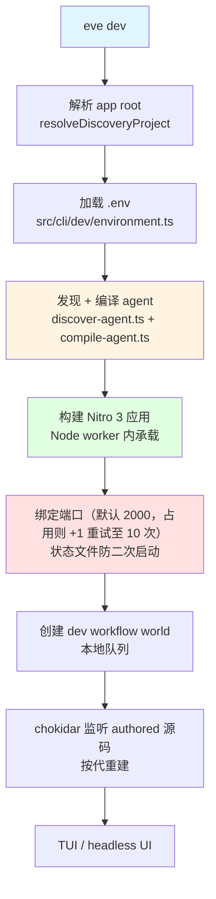
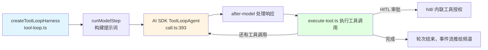
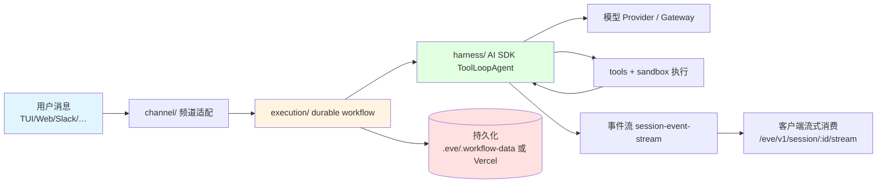
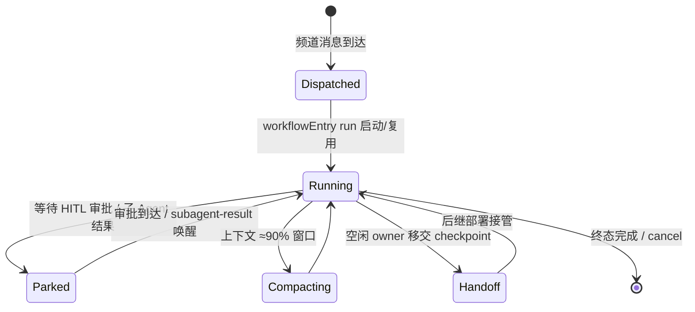
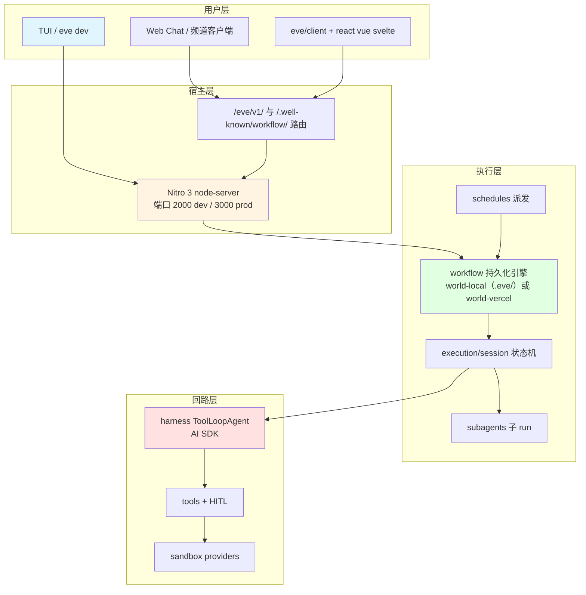

# eve - 运行机制详解

> 生成时间: 2026-10-17
> 分析对象: D:\dev\git\z_jordon\fork\eve（主包 eve@0.80.1，main 分支 c8332e1f）

## 一、项目运行方式

eve 的运行时全部在 `packages/eve` 内（运行时依赖仅 `nitro` + `undici`，其余能力构建期 vendor）。CLI 是唯一入口：`bin/eve.js` 引导（校验 Node 引擎、确保 `dist/src/cli/run.js` 存在，仓库检出会自动补构建）→ commander 程序（`src/cli/run.ts`）。**裸 `eve`** 在已有 app 根时重写 argv 为 `dev`，否则为 `init`。

### 1. 安装与执行

```bash
# 终端用户
npx eve@latest init my-agent   # 脚手架
npm run dev                    # 开发模式（TUI + 热重载）
eve build / eve start / eve deploy / eve eval / eve logs / eve traces

# 仓库开发
pnpm install && pnpm build && pnpm dev   # watch 构建 + weather-agent fixture
```

CLI 子命令一览（注册于 `src/cli/run.ts`）：`init`、`dev`（`src/cli/dev/command.ts:183`）、`start`、`build`（`src/cli/commands/build.ts`）、`deploy`、`set model`、`eval`（委托 `src/evals/cli/eval.ts`）、`info`、`logs`、`traces`、`remote connect|invoke`、`acp`、`extension init|build`、registry/link 系列。

### 2. 启动执行流程（`eve dev`）



生产路径：`eve start` → `startProductionServer`（`src/internal/nitro/host/start-production-server.ts`）子进程拉起 `.output/server/index.mjs`（Nitro node-server 产物），绑定 `0.0.0.0`，端口 `$PORT` 或 **3000**。

## 二、核心运行机制

### 2.1 持久化会话引擎（durable execution）

**位置**: `src/execution/workflow-runtime.ts`、`src/execution/session/entry.ts`、`src/internal/workflow/runtime.ts`

**说明**: 频道收到消息后经 `src/channel/session.ts` → `Runtime.dispatchSession` → 启动/复用一个名为 `workflow//eve//workflowEntry` 的 **durable workflow run**。workflow 体是 `session/entry.ts` 的 `workflowEntry`（带 `"use workflow"` 指令），轮次由 `session/program.ts`（`runPreparedSession`）执行，create-session / coordination-dispatch / turn-step / cancel / 终态完成等步骤分布在 `src/execution/*-step.ts`。

**持久化引擎**是外部 `@workflow/*`（Workflow DevKit）包，按"世界（world）"区分：

| 环境        | world                    | 存储                                                                                         |
| ----------- | ------------------------ | -------------------------------------------------------------------------------------------- |
| 本地 dev    | `@workflow/world-local`  | **文件落盘 `.eve/.workflow-data/`**（`src/internal/workflow/local-world-data-directory.ts`） |
| Vercel 生产 | `@workflow/world-vercel` | 队列 + blob 原语（`vercel-world-defaults.ts`、`world-target.ts`）                            |

会话历史与快照随 workflow 步骤结果**原子持久化**（`durable-session-store.ts` 的 `DurableSessionState`）；每个会话的事件流记录进 workflow run 的事件日志，经 `session-event-stream.ts` 回放，服务于 `GET /eve/v1/session/:id/stream`。**全程无数据库/sqlite** —— dev 是文件系统优先，生产用 Vercel 原语。上下文在窗口约 90% 处触发压缩（`session.ts` 的 `createCompactionConfig`）；空闲 owner 可把 checkpoint 移交给后继部署（`session/handoff.ts`）。

### 2.2 模型回路（harness）

**位置**: `src/harness/tool-loop.ts`、`src/harness/model-call/{run,call}.ts`、`src/harness/execute-tool.ts`

**说明**: 每个轮次：



支持生成中途引导（`generation-steering.ts`）与可中断流（`interruptible-stream.ts`）；工具执行先过 HITL 审批门（`hitl/`、`inline-tool-authorization.ts`）。

### 2.3 频道（channels）与连接（connections）

**位置**: `src/public/definitions/channel.ts`、`src/channel/`、`src/public/channels/`

- 频道 = HTTP 路由动词（GET/POST/…）+ `WS` 升级（`createWebSocketUpgradeServer`）；运行时装配在 `src/channel/{adapter,routes,session}.ts`。
- **eve 频道**（内置 HTTP/SSE）：路由前缀 `/eve/v1`（`src/protocol/routes.ts`）——会话创建、`/session/:id/stream` 可跟随流、cancel/clear/compact/reset、子 Agent 流、连接与 workflow webhook 回调、health/info。
- 其他实现：Slack（`public/channels/slack/`，含审批卡片与 app manifest）、Discord、GitHub、Telegram、Twilio、Teams、Linear、Photon/Linq（iMessage）、chat-sdk、**MCP channel**（把 Agent 发布为 MCP 服务器，`public/channels/mcp.ts`）。
- 连接（出站）：`defineMcpClientConnection`（@ai-sdk/mcp）/ `defineOpenAPIConnection`；OAuth 交互授权回调落在 `execution/connections/callback-route.ts`，授权本身可要求 HITL 审批（`execution/tool-auth.ts`）。

### 2.4 子 Agent 与定时任务

- **子 Agent**：内置 `agent` 工具（`public/tools/agent.ts` → `tools/framework/agent.ts`）从不内联执行——经运行时工具注册表派发给**子 `workflowEntry` run**（`subagents/tool.ts` 的 `buildSubagentRunInput`）；SUBAGENT_ADAPTER（`subagents/adapter.ts`）把子的 HITL 事件代理回父频道；完成时 `subagents/parent-notification.ts` 用 `subagent-result` 唤醒 parked 的父会话。token 预算见 `subagents/token-budget.ts`，进度流走 `/eve/v1/subagent/...`。
- **定时任务**：dev 下**故意不注册 cron**，按需 `POST /eve/v1/dev/schedules/:id` 触发（`dispatch-schedule-in-dev.ts`）；Vercel 生产为每次构建生成**不可猜的 cron 路由** `/eve/v1/cron/<32字节token>` 并写入 Vercel `config.crons[]`（`cron-handler-route.ts`）；Vercel-Schedules 集合再加消费路由（`internal/schedules/consumer-route.ts`）。派发复用同一 workflow runtime。

### 2.5 部署目标

- **Vercel 主路线**：`eve deploy` → `runDeployFlow`（`src/setup/flows/deploy.ts`）→ 按需安装 Vercel CLI → `vercel deploy --prod`（`setup/boxes/deploy-project.ts`）。
- `eve build`：`process.env.VERCEL` 存在则 target=vercel，否则本地 node-server `.output`。Vercel 产物含专用 `flow.func` + 队列触发器（`queue-namespace.ts` 的 `createEveWorkflowQueueTrigger`）、`maxDuration: "max"`；多 Agent workspace 由 `withEve`（`public/vercel/index.ts`）组装成 Vercel services/routes。
- **独立 Node**：任何 Node 24 主机可跑 `.output/server/index.mjs`。
- `packages/eve/Dockerfile` **不是服务器镜像**，而是 Agent **沙箱基础镜像**（Ubuntu 26.04 + Node 24 + git/ripgrep/python/jq + sudo 沙箱用户），供 Docker 沙箱 provider 使用。

## 三、数据流与状态管理

### 4.1 数据流转



### 4.2 关键数据结构

| 结构                                 | 用途                          | 定义位置                                 |
| ------------------------------------ | ----------------------------- | ---------------------------------------- |
| `AgentSourceManifest`                | 发现阶段的 authored 源清单    | `src/discover/discover-agent.ts`         |
| `CompiledAgentManifest` + module map | 编译产物元数据                | `src/compiler/manifest.ts`               |
| `ResolvedAgent`                      | 运行时装配完的 Agent 图       | `src/runtime/resolve-agent.ts`           |
| `DurableSessionState`                | 会话历史 + 快照（原子持久化） | `src/execution/durable-session-store.ts` |

### 4.3 会话状态机



## 四、扩展机制

- **扩展（extensions）**：`agent/extensions/` 挂载 npm 能力包（`defineExtension`），构建期经 `internal/bundler/extension-mount-plugin.ts` 打包；内置 code/git/computer-use 即此机制实现。
- **钩子（hooks）**：`agent/hooks/`，`defineHook`。
- **动态能力**：`defineDynamic` 在 `session.started` / `turn.started` 等事件解析动态工具/指令/技能/子 Agent/模型/连接（`src/context/`、`src/dynamic/`）。
- **沙箱 provider**：`sandbox/providers/default.ts` 链式选择 Vercel → Docker → microsandbox → just-bash；bash 工具是完整启动器（作业控制、`trap USR1`、`set -m`），经 `sandbox.spawn` 在沙箱引擎内执行。
- **可观测**：`.eve/` 下持久化日志与 trace（`eve logs` / `eve traces`）；OTel 追踪基于 `@vercel/agent-runs`（packages/tracing）。

## 五、运行时架构总结



## 总结

eve 运行机制围绕以下核心概念：

1. **编译期/运行期分离**：authored 目录先 discover（零 import）→ compile 到 `.eve/` → nitro-rolldown 打包 → 运行时装配 `ResolvedAgent`。
2. **一切皆 durable workflow**：每会话是 `workflowEntry` run，历史/快照/事件流原子持久化，崩溃可恢复、可移交。
3. **harness 回路可中断可引导**：AI SDK `ToolLoopAgent` + HITL 门 + 生成中途 steering。
4. **频道是一等公民**：从 TUI 到 Slack/MCP 皆是 `defineChannel`，统一走 `/eve/v1` 协议与事件流。
5. **子 Agent = 子 workflow**：HITL 与事件经 adapter 代理，父会话 park/resume。
6. **部署即构建产物**：Vercel（flow.func + 队列触发 + 不可猜 cron 路由）或任意 Node 24 主机。

这种设计使 eve 既**本地一条命令即可跑（文件即状态）**，又**天然适配 Serverless 持久化执行（Vercel 原语）**，非常适合构建需要人工审批、定时任务与长期记忆的后端 Agent。
